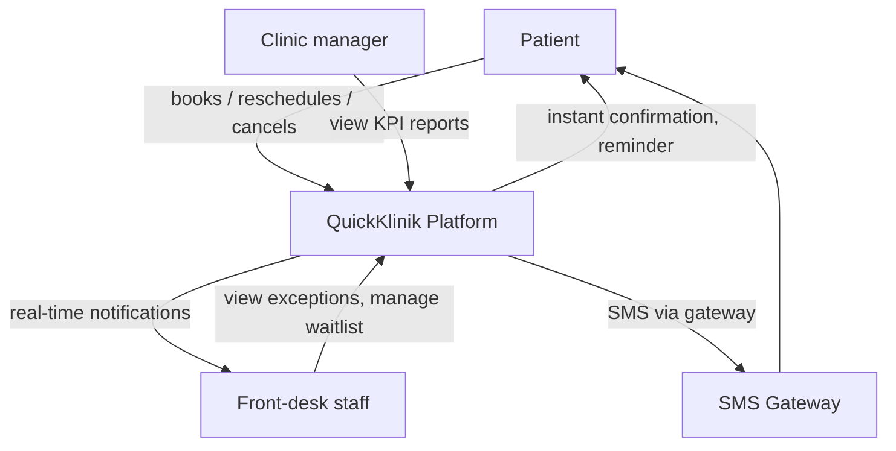

# Project 2 — Requirements Package: Self-Service Reschedule & Auto-Confirm
**Client:** QuickKlinik (fictional) · **Role:** Junior BA · **Timebox:** Weeks 3–4 · **Status:** Complete
**Business question:** What exactly must the new solution do, and how will we know it is right?
**Scenario:** The To-Be process from Project 1 becomes a build project: instant auto-confirmation + patient self-service reschedule/cancel, delivered first; SMS/push reminders follow (business-cased in Project 3).

## 1. Project scope (one page)
- **Objectives:** (1) auto-confirm free slots instantly; (2) let patients reschedule/cancel without calling; (3) release cancelled slots to a waitlist.
- **In scope:** web-app patient flows, admin panel notifications, waitlist matching (basic), audit logging, KPI event logging.
- **Out of scope:** payments, telemedicine video, multi-language (Phase 2), native mobile apps.
- **Success criteria:** 100% of free-slot bookings auto-confirmed <60s; ≥60% of reschedules done self-service in month 3; zero P1 defects at UAT exit.
- **Constraints:** 2 engineers × 6 weeks; must reuse existing auth; must comply with Malaysian PDPA (personal data).
- **Assumptions:** SMS gateway contract signed separately (Project 3); clinics' opening hours data is accurate.

## 2. Stakeholder interview plan & mock meeting notes
**Plan:** 3 sessions — clinic manager (value/priority), receptionist (process detail), product owner (feasibility). Questions drawn from interview guide template.

**Mock meeting notes (PO + Clinic manager, Sprint-0 discovery):**
- Decided: waitlist matching is basic (first-come SMS offer), not smart ranking. *Open question:* how long to hold an offered slot? → PO to check with 2 clinics; answer: 15 minutes.
- Decided: cancelled <2h before appointment still flags clinic (they may want to call). *Open:* who owns the phone fallback? → Clinic manager.

## 3. Requirements (extract — full list in `BA_Project_Tracker_Filled.xlsx`, 20 requirements)
| Req ID | Type | Requirement statement | Source | MoSCoW | Rationale / business value |
|---|---|---|---|---|---|
| BR-001 | Business | Reduce no-show rate from 18% to ≤10% within 6 months of go-live. | Clinic manager | Must | Slots are the product; empty slots are lost revenue |
| FR-001 | Functional | The system shall automatically confirm a booking within 60 seconds when the requested slot is free. | Process map gap #1 | Must | Removes 24h uncertainty; kills step-4 phone call |
| FR-002 | Functional | The system shall let a patient reschedule or cancel a confirmed booking in the web app. | Process map gap #3; patient interview | Must | ~30% abandon phone reschedule → no-show |
| FR-003 | Functional | The system shall notify the clinic in real time when a booking is rescheduled or cancelled. | Receptionist interview | Must | Clinic plan their day; front-desk exceptions only |
| FR-004 | Functional | The system shall release cancelled slots to a waitlist and offer them by SMS in order of request. | PO decision in mock notes | Should | Recovers slot value same-day |
| FR-005 | Functional | The system shall flag cancellations made less than 2 hours before appointment time. | Mock meeting decision | Should | Clinic may still call patient |
| NFR-001 | Non-functional | The confirmation endpoint shall respond in <2 s at 95th percentile under 20 bookings/min. | Engineering lead | Must | UX expectation; load from 14 clinics |
| NFR-002 | Non-functional | Personal data (name, phone, appointment) shall be encrypted in transit and at rest per PDPA. | Legal/policy constraint | Must | Legal compliance; trust |
| NFR-003 | Non-functional | Booking flows shall meet WCAG 2.1 AA contrast and keyboard navigation. | Product standard | Should | Accessibility for older patients |
| NFR-004 | Non-functional | All booking/reschedule events shall be audit-logged with timestamp and actor. | Ops requirement | Must | Dispute handling; KPI source |

**MoSCoW summary:** 4 Musts justified above (one sentence of business value each); Shoulds add value but are time-boxed; Coulds (email digest, multiple reminders) deferred to Phase 2. *Check: no requirement contains a solution — they state what, not how.*

## 4. Context diagram (actors ↔ system)

## 5. User stories with Given/When/Then acceptance criteria (12 of 12)
| Story ID | Epic | User story | Acceptance criteria (Given/When/Then) | MoSCoW | Points |
|---|---|---|---|---|---|
| US-001 | Booking | As a patient, I want instant confirmation when I book a free slot so that I know my appointment is secured. | Given a free slot and valid details, when I tap Confirm, then status becomes CONFIRMED and a confirmation with details is shown in <60s. | Must | 5 |
| US-002 | Booking | As a patient, I want to see clinic address and prep instructions in the confirmation so that I arrive prepared. | Given a confirmed booking, when I open it, then I see clinic address, date/time, and any prep notes the clinic entered. | Must | 2 |
| US-003 | Reschedule | As a patient, I want to reschedule my booking in the app so that I don't have to phone the clinic. | Given a confirmed booking >2h away, when I choose a new free slot and confirm, then the old slot is released, the new one is CONFIRMED, and I see the updated details. | Must | 8 |
| US-004 | Reschedule | As a patient, I want to cancel my booking in the app so that the clinic isn't waiting for me. | Given a confirmed booking, when I tap Cancel and confirm, then status becomes CANCELLED and the clinic is notified immediately. | Must | 5 |
| US-005 | Reschedule | As a patient, I want to be warned if my change is inside 2 hours so that I know the clinic may still contact me. | Given a booking starting in <2h, when I attempt reschedule/cancel, then a warning shows and the action is flagged to the clinic on completion. | Should | 3 |
| US-006 | Waitlist | As a patient on a waitlist, I want to be offered released slots by SMS so that I can get an earlier appointment. | Given a cancelled slot and I'm first on the waitlist, when the slot is released, then I receive an SMS with a 15-minute hold link; if I accept, the slot is CONFIRMED, else it passes to the next patient. | Should | 8 |
| US-007 | Clinic | As front-desk staff, I want real-time notifications of changes so that I don't need to watch the panel all day. | Given a reschedule/cancel/waitlist event at my clinic, when it occurs, then the notification badge and event list update within 5s. | Must | 5 |
| US-008 | Clinic | As front-desk staff, I want to see today's exceptions (late cancels, failed offers) in one list so that I only make necessary calls. | Given I open the admin panel, when I filter to today, then I see an exceptions list sorted by appointment time with patient phone number. | Must | 5 |
| US-009 | Clinic | As a clinic manager, I want a no-show/reschedule KPI report so that I can measure improvement. | Given month-end, when I open Reports, then I see no-show rate, reschedule rate, auto-confirm % vs baseline, exportable to CSV. | Should | 5 |
| US-010 | Platform | As the product owner, I want all events audit-logged so that disputes can be resolved. | Given any booking event, when it happens, then an audit record with actor, timestamp, before/after state is written and retrievable by support. | Must | 3 |
| US-011 | Platform | As the platform, I must respond fast at peak so that patients don't abandon. | Given 20 bookings/min, when p95 latency is measured, then confirmation and reschedule endpoints respond <2s. | Must | 5 |
| US-012 | Booking | As a patient, I want the flow to work with screen readers and high contrast so that I can use it with a disability. | Given WCAG 2.1 AA checks, when audited, then booking, reschedule and cancel flows pass contrast and keyboard navigation. | Should | 3 |

*INVEST check: each story is independent (own AC), negotiable, valuable to a named user, estimable (points), small (≤8 pts), testable (GWT).*

## 6. Wireframe specifications (3 key screens — build in Figma free)
1. **Booking confirmation screen:** success banner; booking card (clinic, doctor, date/time, address, prep notes); buttons [Reschedule] [Cancel] [Add to calendar]; confirmation timestamp.
2. **Reschedule picker:** calendar strip of next 14 days; only free slots selectable; selected slot highlighted; [Confirm change] primary button; 2h-warning banner if applicable.
3. **Clinic exceptions dashboard:** today's list (patient, time, type: late-cancel/failed-offer, phone); filter chips; notification badge; link to KPI report.

*(Figma frames: patient mobile 390×844, admin desktop 1440×1024. Link each frame to the story IDs above in Figma comments.)*

## 7. Data dictionary (main entities)
| Entity.Field | Type | Rules | Source |
|---|---|---|---|
| Booking.id | UUID | PK, system-generated | Platform |
| Booking.status | Enum(PENDING, CONFIRMED, RESCHEDULED, CANCELLED, COMPLETED, NO_SHOW) | state machine; PENDING removed by this project | System |
| Booking.slot_id → Slot.id | UUID | FK, must be free to confirm | Clinic schedule |
| Booking.patient_id → Patient.id | UUID | FK; PDPA data | Auth service |
| Booking.created_at / confirmed_at | Timestamp | confirmed_at − created_at <60s for auto-confirm KPI | System |
| Cancellation.hours_before_appt | Decimal | derived; <2 flags exception | System |
| WaitlistEntry.position | Integer | per clinic+specialty; FIFO | System |

## 8. Self-review checklist
- [x] Each requirement testable ("within 60 seconds", "<2 s at p95")
- [x] Unambiguous (no "fast", "user-friendly" without measure)
- [x] Traceable (ID → source → story → UAT test in Project 4)
- [x] Not a solution in disguise ("notify in real time", not "use WebSocket")

**Deliverables shipped:** scope page ✓ · BRD ✓ · 12 user stories with AC ✓ · wireframe specs ✓ · data dictionary ✓ · requirements sheet ✓
